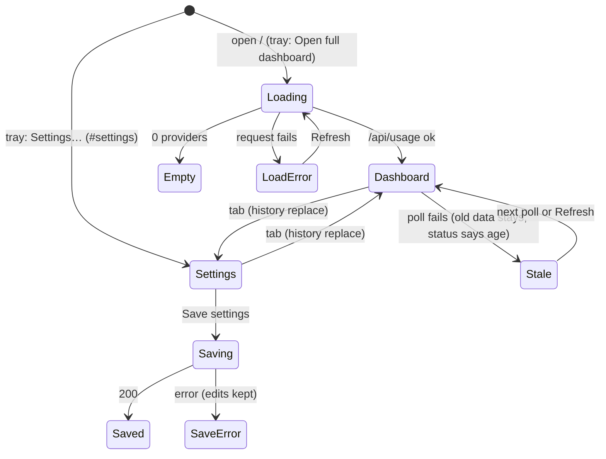

# UX review 2026-11-08: dashboard, settings and corner widget

Branch: `ui/ux-polish-2026-11-08`. Scope: `public/` (dashboard, settings view, widget). No provider, auth, token-reading or login-launch logic changed.

## Screens and states

Back: tabs replace the history entry, so one Back leaves the page. There are no overlays, so there is nothing for Escape to close.

There is no login screen in this app. `src/login-launch.ts` registers the app to start at OS login. `claude auth login` runs in the terminal from `tuw setup`. I did not change either.

## Design plan

- Product: a local fuel gauge for AI-agent quotas. The main job is "how much is left, and when does it reset".
- Hero: each meter shows a large "66.0% left" readout. Amber or red tone shows on the readout and on the meter. "Used", tokens and reset time sit under the meter in small text.
- Color: `--bg #04141c` (same as the Electron window), `--surface #0a222d`, `--line #1d3a46`, ink `#e6f1f3` / `#a3bec5` / `#7d9ba3`, tones `--ok #3ccfbe`, `--warn #f2b25c`, `--danger #ff7a90`. All text is 5.5:1 or more.
- Type: the system UI font (Segoe UI Variable on Windows), with tabular figures. This is a native desktop utility, so it does not load web fonts. Scale is 12 / 14 / 16 / 20 / 32 px.
- Spacing: 4 / 8 / 12 / 16 / 24 / 32 / 48 px.
- Removed AI tells: aurora gradient blobs, infinite pulse dot, glow shadows, gradient meters and buttons, all-caps labels, middle-dot reset strings, identical stretched cards.

## Findings

| # | Issue | File:line (before) | Severity | Fixed | Evidence |
|---|---|---|---|---|---|
| 1 | Page scrolls sideways at 400 px: `scrollWidth` 1194 px. The grid min column was 360 px and the grid was nested in a second grid. | `public/styles.css:188-196` | High | Yes. One grid, `minmax(min(100%, 320px), 1fr)`. | `scrollWidth` 385 at 400 px. [before](ux-2026-11-08/before-dashboard-400.png), [after](ux-2026-11-08/after-dashboard-400.png) |
| 2 | OpenRouter said "Credits remaining $7.66 of $20.00", but $7.66 is the amount used. The widget said "$12.34 left". | `public/app.js:145-166` | High | Yes. Large "$12.34 left", then "$7.66 of $20.00 used". | [after](ux-2026-11-08/after-dashboard-1280.png) |
| 3 | First load showed an empty grid. Zero providers showed an empty grid. A failed first load showed only a footer line. | `public/app.js:324-357` | High | Yes. Loading text (after 300 ms), empty state with `tuw setup`, error state with what to do and Refresh. | [loading](ux-2026-11-08/after-loading.png), [error](ux-2026-11-08/after-first-load-error.png) |
| 4 | A failed poll said `Failed to load: Failed to fetch` in the footer, with no data age. | `public/app.js:352-354` | High | Yes. "Could not refresh at 9:09 PM. The usage server does not answer. Start it with tuw start… Showing data from 9:09 PM." Old cards stay. | [after](ux-2026-11-08/after-refresh-error.png) |
| 5 | No way to refresh by hand. A timer and a click could run two loads at once. | `public/app.js:344` | Medium | Yes. Refresh button. One load at a time (single-flight). The button dims only after 300 ms. | Playwright: double click, 1 request |
| 6 | Save settings: the button stayed active while it saved, so a double click sent two PUTs. "Saved" never cleared. Errors said `Save failed: HTTP 500`, and a non-JSON answer threw a parse error. | `public/app.js:430-450` | High | Yes. Button disabled while it saves. "Unsaved changes." on edit. "Settings saved." on success. "Could not save. <reason> Your changes are still here. Try again." on error. | 1 PUT for 2 submits. [error](ux-2026-11-08/after-settings-save-error.png) |
| 7 | Each tab click pushed a history entry, so Back walked through every Dashboard/Settings switch. | `public/index.html:31-32` | Medium | Yes. Tab click uses `location.replace`. Reload keeps the view. Focus moves to the new view. `aria-current="page"` on the active tab. | 5 tab clicks: `history.length` +0. One Back leaves the page. |
| 8 | Header clock ticked every second and showed the current time, not the data time. The pulse dot pulsed even when loads failed. | `public/index.html:35-36`, `public/app.js:478` | Medium | Yes. Removed both. One status line under the title: "Updated 9:09 PM. Refreshes every 1 minute." | [after](ux-2026-11-08/after-dashboard-1280.png) |
| 9 | Infinite aurora blob animation and pulse, with no `prefers-reduced-motion` rule. | `public/styles.css:42-93,152-170` | Medium | Yes. Removed. Only motion now: 160 ms view cross-fade, 250 ms meter width, chevron turn. A reduced-motion rule sets all of them to 1 ms. | Reduced motion: `animationDuration` 0.001s |
| 10 | Every card said "LIVE", also in sample-data mode. | `public/app.js:286` | Low | Yes. Removed. The error text is the one signal for a failed provider. | [after](ux-2026-11-08/after-dashboard-1280.png) |
| 11 | "Tokens —" showed on every meter, because most providers give no token count. | `public/app.js:137-140` | Low | Yes. The token count shows only when there is one. | [after](ux-2026-11-08/after-dashboard-1280.png) |
| 12 | Grid rows stretched every card to the tallest one, so cards had large empty areas. | `public/styles.css:188-208` | Low | Yes. `align-items: start`. | [before](ux-2026-11-08/before-dashboard-1280.png), [after](ux-2026-11-08/after-dashboard-1280.png) |
| 13 | Labels mixed "5-Hour Window" (dashboard) and "5-hour window" (settings). | `public/app.js:2-4` | Low | Yes. Sentence case everywhere. | |
| 14 | Settings copy was wrong: "Dashboard always shows the full card" is false, because the dashboard hides the lines you turn off. Other hints used jargon ("upstream poll"). | `public/index.html:50,87` | Medium | Yes. Plain copy. The config path now shows (the `data-config-path` target was missing). | [after](ux-2026-11-08/after-settings-1280.png) |
| 15 | Touch targets: nav 28 px, checkbox rows 20 px, Cursor toggle 20 px, selects 40 px. | `public/styles.css:474-489,602-611,684-688` | Medium | Yes. All 44 px or more. | Playwright: 0 controls under 44 px on both views at 400 px |
| 16 | No visible focus style. Each poll redraw dropped keyboard focus on the Cursor toggle. | `public/styles.css`, `public/app.js:333` | Medium | Yes. One `:focus-visible` ring. Focus is put back after a redraw. Refresh and Save use `aria-busy`, not `disabled`, so they keep focus too (review round 1). | Playwright: focus stays on `.bill-summary`, `#refresh-now` and `#settings-save` |
| 17 | Contrast: `--ink-faint #5a8089` was 3.8:1 on cards. The widget `--faint #54707a` was 3.5:1. | `public/styles.css:6`, `public/widget.css:5` | Medium | Yes. `#7d9ba3` (5.5:1 or more). | Contrast script |
| 18 | Many type sizes (10 to 30 px, 12 sizes) and random spacing. Meter colors differed between providers (blue for Cursor, teal for others). | `public/styles.css` | Low | Yes. Tokens for color, type and space. One meter style. | |
| 19 | The dashboard loaded Google Fonts. This is a localhost-only, privacy-first app, and the fonts fail offline. | `public/index.html:8-10` | Medium | Yes. System font stack. No external requests. | |
| 20 | Reset text used a middle dot: "Resets in 3 days · Nov 12". | `public/fmt.js:37` | Low | Yes. "Resets in 3 days 5 hours (Nov 12, 2:09 AM)". Tests updated. | `tests/format-reset.test.cjs` |
| 21 | Widget status said `fail`. The reason was only in a tooltip. With no data yet, the body stayed empty. | `public/widget.js:111` | High | Yes. "Update failed. Retrying." The tooltip keeps the reason. With no data, the body says "Cannot load usage: <reason>". | [after](ux-2026-11-08/after-widget-error.png) |
| 22 | Widget buttons were 18 px glyphs with no accessible name. Quit sat right next to Hide. | `public/widget.html:17-19`, `public/widget.css:60` | Medium | Yes. 24 px, `aria-label`, clear tooltips, a gap before Quit, red hover on Quit, focus ring. | [after](ux-2026-11-08/after-widget.png) |
| 23 | Widget: all-caps "USAGE" title, "FAKE" badge, "↻ 8:59:58 PM" status, "No providers" empty text, blank body on first paint. | `public/widget.html:15,26-27`, `public/widget.js:78,81` | Low | Yes. "Token usage", "sample data", "Updated 8:59 PM", "No providers are on. Run tuw setup…", "Loading usage…". | [before](ux-2026-11-08/before-widget.png), [after](ux-2026-11-08/after-widget.png) |
| 25 | The Cursor details never collapsed. `.bill-details { display: flex }` beat the `hidden` attribute. (Found in review round 1; the old CSS had the same bug.) | `public/styles.css` (before: `:509`) | Medium | Yes. Global `[hidden] { display: none !important }`. | Playwright: `display: none` after a click and after a poll. [after](ux-2026-11-08/after-cursor-collapsed.png) |
| 26 | A card whose windows are all "unavailable" told the person to change Settings, and dropped the window's reason. (Review round 1.) | `public/app.js` (renderProvider) | Medium | Yes. The note shows the window's own reason. The Settings hint shows only for Claude, whose meters Settings can hide. | Playwright: "Codex has not reported a weekly window yet." |
| 27 | After a save, a load that started before the save could apply the old settings for one cycle. (Review round 1.) | `public/app.js` (saveSettings) | Low | Yes. Save waits for the running load, then loads again. | Code |
| 28 | Any `TypeError` (also a code bug) said "The usage server does not answer". (Review round 1.) | `public/app.js` (loadErrorText) | Low | Yes. Only a failed `fetch` gives that text (`fetchServer`). | Code |
| 29 | A first-load error left `aria-busy="true"` on the grid. (Review round 1.) | `public/app.js` (showGridState) | Low | Yes. `showGridState` removes it. | Code |
| 30 | The Cursor details faded in on every poll redraw. (Review round 1.) | `public/styles.css` (.bill-details) | Low | Yes. Animation removed. | Code |
| 31 | Edits made while a save ran were overwritten, and the status said "Settings saved." (Review round 1.) | `public/app.js` (saveSettings) | Low | Yes. The form keeps them. The status says "Settings saved. Your newer changes are not saved yet." | Playwright: edit kept |
| 32 | No tests for single-flight refresh or the balance display. (Review round 1.) | `tests/refresh-runtime.test.ts` | Low | Yes. Two tests added. | `npm test` |
| 24 | Widget page background `#0a161c` did not match the Electron window `#04141c`, so the first paint changed color. | `public/widget.css:2` | Low | Yes. `#04141c`. | `tests/server-launch.test.cjs:743` pins the window color |

## Kept on purpose

- Widget buttons are 24 px, not 44 px. The widget is a 320 x 172 px always-on-top corner window, used with a mouse. 44 px would double its header. 24 px meets WCAG 2.2 target size (2.5.8).
- The compact widget line keeps "· 12d" (`public/widget-compact.js:62`). It is a data separator in a 44-character line. The line-wrap logic and `tests/widget-compact.test.cjs` depend on it.
- One dark theme only. The app had no light theme before, and the widget is dark.

## Checks

| Check | Result |
|---|---|
| `npm run verify` (typecheck, build, tests, e2e evidence) | exit 0. Tests 280: 277 pass, 0 fail, 3 skipped. `E2E PASS`. |
| Browser (Playwright, fixture server on port 4310) | No sideways scroll at 400 px. 0 controls under 44 px. Back: 1 press leaves the page. 1 PUT for 2 submits. Failed save keeps the edit. Failed poll keeps 7 cards. Loading text hidden at 100 ms, shown at 700 ms. Focus stays on Refresh and Save. Cursor details collapse. |

Independent review: see [review-pr-5](review-pr-5-8c35a27.md).

## Screenshots

Before: [dashboard 1280](ux-2026-11-08/before-dashboard-1280.png), [dashboard 400](ux-2026-11-08/before-dashboard-400.png), [settings 1280](ux-2026-11-08/before-settings-1280.png), [widget](ux-2026-11-08/before-widget.png).

After: [dashboard 1280](ux-2026-11-08/after-dashboard-1280.png), [dashboard 400](ux-2026-11-08/after-dashboard-400.png), [settings 1280](ux-2026-11-08/after-settings-1280.png), [settings 400](ux-2026-11-08/after-settings-400.png), [loading](ux-2026-11-08/after-loading.png), [first-load error](ux-2026-11-08/after-first-load-error.png), [refresh error](ux-2026-11-08/after-refresh-error.png), [save error](ux-2026-11-08/after-settings-save-error.png), [widget](ux-2026-11-08/after-widget.png), [widget error](ux-2026-11-08/after-widget-error.png), [Cursor collapsed](ux-2026-11-08/after-cursor-collapsed.png).

## Open items

None.
