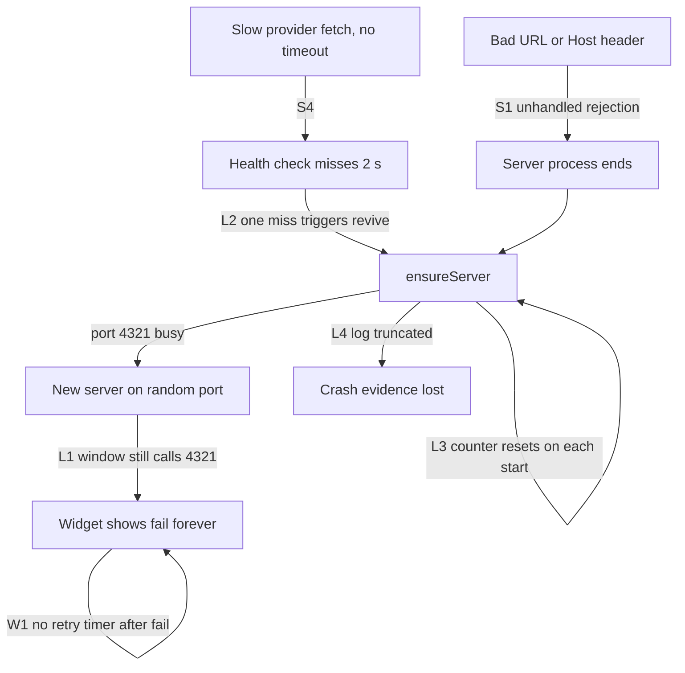

# Code review: server, desktop lifecycle, CLI and frontend (2026-10-13)

## Scope

- Base: `master` at `71f4db8`, plus the uncommitted OpenCode removal (see `2026-10-13-opencode-cookie-removal.md`).
- Three reviewers read the code in parallel. Each claim was checked against the code. Some claims were also run as a test.
- No code was changed by this review.

## Main failure chain

These defects combine. Together they explain the "fail" widget, the server churn and the orphan servers.

## Findings

Severity: H = high, M = medium, L = low. Status: R = reproduced, C = confirmed by reading the code.

### Data loss and crashes

| ID | Sev | Where | Defect | Status |
|---|---|---|---|---|
| C1 | H | `src/cli/provider-config.ts:116` | `loadExisting` returns `{}` on a JSON parse error (also on a UTF-8 BOM from Notepad). The next `writeConfig` deletes all API keys, `lanToken` and flags. The CLI and `PUT /api/settings` (`src/settings-api.ts:32`) both do this. | R |
| C2 | H | `src/cli/provider-config.ts:155`, `src/config.ts:226` | `writeFileSync` writes in place, so the write is not atomic. A crash leaves a truncated file. C1 then deletes the secrets. | C |
| S1 | H | `src/server.ts:111,148` | `decodeURIComponent` and `new URL(...)` throw in the async handler. No code catches the error. On Node 15 and later, the process ends. Example: `GET /%E0%A4%A`. | R |
| A1 | H | `src/adapters/claude.ts:146-170,219-223` | The widget refreshes the Claude OAuth token with the Claude Code client ID and writes the rotated tokens to `~/.claude/.credentials.json`. It uses no lock. A running Claude Code session can lose its login. This is also the strongest "credential theft" signal for antivirus. | C |
| A2 | M | `src/adapters/claude.ts:213-219` | `ensureFreshClaudeToken` runs outside the `try`. One network error rejects `Promise.all`, and `/api/usage` returns 500 for all providers. | C |

### Server lifecycle (desktop)

| ID | Sev | Where | Defect | Status |
|---|---|---|---|---|
| L1 | H | `desktop/main.cjs:126-145`, `public/widget.js:92` | The revive saves a new `serverEndpoint`, but the window loads its URL only once. `fetch("/api/usage")` stays on the old port. The revive also always asks for the configured port, not the current one. | C |
| L2 | M | `desktop/main.cjs:172-184`, `desktop/server-launch.cjs:244,264` | One health miss (2 s) starts a revive. A second miss on a live but slow server starts a server on a fallback port. | C |
| L3 | M | `desktop/main.cjs:139` | `reviveFailures = 0` after each start. A server that crashes 3 s after start restarts forever. `MAX_REVIVE_FAILURES` never stops it. | C |
| L4 | M | `desktop/server-launch.cjs:293` | `writeFileSync` truncates the server log on each start. The revive runs 400 ms after a crash and deletes the stack trace. | C |
| L5 | M | `scripts/start-widget.cjs:41` | `cmd.exe /s /c` removes the quotes that Node adds. A checkout path with a space fails: `'...\sp' is not recognized`. | R |
| L6 | M | `src/cli/refresh-runtime.ts:461-487` | `taskkill /PID … /T /F` stops whatever process listens on the port. It does not check `/api/health` first. It can stop an unrelated dev server on 4321. Same pattern: `freePort` in `desktop/server-launch.cjs:108`. | C |
| L7 | L | `desktop/server-launch.cjs:244-254`, `src/server.ts:102` | Any service that returns `{"status":"ok"}` on `/api/health` is used as the widget server. | C |
| L8 | L | `desktop/server-launch.cjs:302` | After an Electron crash, the server lives on and is adopted as "not owned". Quit never stops it, and it keeps old code after a rebuild. | C |
| L9 | L | `scripts/start-widget.ps1:18` | `Join-Path $env:NVM_SYMLINK` fails when the variable is not set. | R |
| L10 | L | `scripts/start-widget.ps1:30`, `desktop/main.cjs:45` | `-Fixture` sets `USAGE_FIXTURE`, but `main.cjs` deletes it without `--fixture` in argv. | C |

### Server and adapters

| ID | Sev | Where | Defect | Status |
|---|---|---|---|---|
| S2 | M | `claude.ts:179,360`, `cursor.ts:228`, `kimi.ts:99`, `grok.ts:38`, `zai.ts:46` | No `fetch` has a timeout. One hung provider blocks `/api/usage` for all providers for up to about 300 s. | C |
| S3 | M | `src/adapters/cursor.ts:185-193`, `package.json` `engines` | The copy fallback runs on any read error, not only on a lock. Without `node:sqlite` (Node before 22.13), each poll copies the ~1 GB DB two times and still fails. This machine runs Node 24, so the in-place read works here. | C |
| S4 | M | `src/config.ts:153` | `loadConfig` merges `config.example.json` first, which turns on `openai` and `cursor`. Before setup, the widget reads the Cursor token and spawns `codex`. | C |
| S5 | M | `src/adapters/zai.ts:11` | `root.limits ?? root.data` does not handle `{data:{limits:[…]}}`. The live shape is not verified. | C |
| S6 | L | `src/server.ts:146-171` | No Host header check. A DNS rebinding page can read `/api/usage` and `PUT /api/settings`. | C |
| S7 | L | `src/settings-api.ts:36` | The old `opencode.go.authCookie` stays in `config.json` and is copied on migrate. | C |
| S8 | L | `src/poll-cache.ts:103,108` | A cache hit sets `fetchedAt` to now. Old data shows as fresh. | C |

### Frontend and CLI

| ID | Sev | Where | Defect | Status |
|---|---|---|---|---|
| W1 | H | `public/widget.js:82,97-112` | Only `renderAll` calls `scheduleRefresh()`. If the first load fails, no timer runs, and the widget shows `fail` until restart. | C |
| W2 | M | `public/app.js:319` | `renderAll` calls `populateSettingsForm()` on each refresh. It deletes unsaved user edits. | C |
| W3 | M | `src/cli/setup.ts:45,92` | No readline `close` handler. `tuw setup < /dev/null` exits 0 and writes no config. | R |
| W4 | L | `src/cli/setup.ts:113`, `src/cli/providers.ts:55` | The secret prompt shows the pasted key in plain text. | C |
| W5 | L | `public/fmt.js:25-32` | The text shows "Resets in 0 minutes" and "1 day 0 hours". | C |
| D1 | L | `README.md:138,178,228`, `README.md:14` vs `package.json` | The docs say "all providers off" and "eight providers", and mention Firefox. The repo owner in the links is different. | C |

## Checked and clean

- The server binds to `127.0.0.1` by default. It sends no CORS headers. The path traversal guard works.
- No token appears in responses or logs. Cursor temp copies are deleted in `finally`.
- Electron: `contextIsolation` and `sandbox` are on, and `nodeIntegration` is off. `openExternal` opens only URLs the app builds.
- The renderer escapes provider strings, so no XSS was found.
- The new logon shortcut targets `electron.exe` directly. No hidden PowerShell runs at logon.

## Recommended fix order

1. C1 + C2: throw on a bad parse and strip the BOM. Write atomically with tmp + rename.
2. S1: put a `try/catch` around the whole handler and return 400.
3. W1 + L1: always schedule the refresh. Reload the window when `baseUrl` changes, and revive on the current port.
4. S2: `signal: AbortSignal.timeout(10_000)` on each fetch.
5. L2 + L3 + L4: revive after 3 misses, reset the counter after 60 s healthy, and append to the log.
6. A1: stop writing to `~/.claude/.credentials.json`. Show "run `claude`" on a 401.
7. The rest, by severity.

## Open items

- Not in scope: GitHub Dependabot reports 67 alerts on `master` (25 high, 37 moderate, 5 low). Review them separately.
- The OpenCode removal and the logon and orphan-server fixes are still uncommitted in the working tree. They wait for the owner's commit decision.
- No fixes from this review are made yet. The next step is the fix order above, after owner approval.
