# 2026-10-16 logic hunt: feedback loops and broken logic

Status: done. 39 unique findings: 30 CONFIRMED, 9 PLAUSIBLE (D 3, A 10, B 12, CLI/UI 14 after 4 duplicates). Commander spot-checked 2 or more items per agent area.

```mermaid
flowchart TB
  F[Feedback loops: a forced or lossy value saved as truth] --> F1[D0 window grows 1.25x per start, fixed]
  F --> F2[D3 monitor drop moves the saved home]
  F --> F3[B3 blank select saves 30 s poll]
  F --> F4[B6 deleted config comes back]
  F --> F5[CLI-1 and CLI-2 setup overwrites flags and edits]
  S[Old data shown as fresh] --> S1[B1 response time, not data age]
  S --> S2[B2 TTL equals refresh period]
  S --> S3[A2 Claude cache with no age limit]
  S --> S4[B8 one error replaces good data]
  X[Dead or misleading logic] --> X1[D1 fit never changes height]
  X --> X2[D2 parked widget stays visible]
  X --> X3[A1 codex % is left, others used]
  X --> X4[A3 error guard never true]
  X --> X5[B4 bad JSON shows No providers]
```

The D0 fix is in the working tree, not committed yet (desktop/main.cjs, desktop/widget-dock.cjs, tests/server-launch.test.cjs). The owner decides on the commit.

Probe: a scratch probe (not in the repo) runs the real `runWidgetMain` with a scratch userData dir and a fake cursor.

## D0 (fixed in working tree) Widget grows 1.25x at each start on a 125% monitor
- desktop/main.cjs createWindow: `new BrowserWindow({x,y,width,height})` returns 280x178 for 221x141. App saved getBounds() as truth.
- Evidence: 3 real starts saved 221 -> 280 -> 352 -> 440. After fix: 4 starts keep 221x141.

## D1 CONFIRMED Fit to content never changes the height
- public/widget.js fitToContent: `Math.max(root.scrollHeight, rect.height)`. The root scrollHeight is never smaller than the viewport.
- desktop/main.cjs fitWindowToContent: `Math.min(b.height, ceil(h))` refuses to grow.
- Evidence: seed 320x400, userSized false. Renderer: inner 400, scrollH 400, rectH 123. Window stays 401 px.
- Result: a widget that is too tall keeps empty space. A widget that is too short clips rows (html overflow hidden, no scroll without user-sized).
- Fix idea: measure `document.body.getBoundingClientRect().height`; let main grow and shrink within MIN/MAX and the work area.

## D2 CONFIRMED A parked widget slides onto the next monitor, or over the taskbar
- desktop/widget-bounds.cjs nearestDockEdge/dockedBounds use only the current work area. They ignore a neighbor display and the taskbar.
- Evidence: default corner (primary bottom-right) parks to y=1000..1141. Screenshot (taken 2026-10-16, not in the repo): the whole widget stays visible, covers the tray icons and clock, and shows on the monitor below.
- Primary right edge parks to x=1888..2110, which is on the 125% monitor to the right.
- Fix idea: skip an edge when the parked rectangle meets another display or leaves the work area into the taskbar; if no edge is free, do not park.

## D3 CONFIRMED A monitor that goes away moves the saved home for good
- desktop/main.cjs reanchorWindow clamps `dock.getRest()` into the remaining display and stores it as the new rest. Quit saves it.
- Evidence: rest on the 125% monitor (3235,882). Simulated display-removed then display-added. Saved file after quit: x=1699 (primary). The widget does not go back.
- This machine uses Modern Standby, so monitors drop at sleep.
- Fix idea: keep the user home separate from the clamped placement; on display-added, restore the home when its display is back.

## Adapters and widget line (agent hunt)

Spot-checked by commander: A2 (claude.ts:292,302 read back) and A9 (fmt.js:53 read back). Both hold.

Codex "Month 0%" answer: the value is correct, but its label misleads. Raw Codex data: `usedPercent: 100`, `rateLimitReachedType: "rate_limit_reached"`, window 43200 min, limits `planType: "free"` while the account `planType` is `"plus"`. The dashboard shows 100% used. The 25d 23h reset is correct.

| id | file:line | defect | verdict |
|----|-----------|--------|---------|
| A1 | public/widget-compact.js:184,41 | Codex "N%" means left; every other provider "N%" means used. No word shows which. Live: `codex: Month 0%` = quota empty. | CONFIRMED (live) |
| A2 | src/adapters/claude.ts:90-94,292,302 | On 429, 5xx or network error, the adapter returns old `cachedOk` with no age limit and no `error`. Repro: 6 h later shows `claude: 5h 95% (now)`, error undefined. | CONFIRMED |
| A3 | public/widget-compact.js:122,143,149,180 | Error guard `!p.windows && !p.balance` is never true (adapters always return windows). cursor, openrouter, grok show `NA` instead of `HTTP 401` / `not signed in`. | CONFIRMED |
| A4 | src/adapters/cursor.ts:109-150, public/app.js:204-207 | Live Cursor says "You've hit your usage limit" (spend 54570 of limit 7000 cents, `remainingBonus: false`). Widget shows `total 42%`; the message shows nowhere. | PLAUSIBLE |
| A5 | src/adapters/kimi.ts:140,178-187 | The kimi-cli payload shape (`usage`/`limits`) maps to no window: `kimi: NA`, no error. Shape from memory; no live key. | PLAUSIBLE |
| A6 | src/adapters/zai.ts:96 | Every `TOKENS_LIMIT` entry maps to `five_hour`; a weekly entry overwrites the 5h value. Live shape not verified. | PLAUSIBLE |
| A7 | public/widget-compact.js:12, src/adapters/cursor.ts:49-51,141 | `Math.round` turns 99.6% used into "100%" and "0% left". | CONFIRMED |
| A8 | src/adapters/grok.ts:59, src/adapters/openrouter.ts:42 | `Number(null)` is 0: null becomes `0 credits left` / `$0.00 left`. | PLAUSIBLE |
| A9 | public/fmt.js:53,59 | Short reset text shows `0m` when less than 30 s are left. | CONFIRMED |
| A10 | src/adapters/claude.ts:192-194 | When `seven_day` is null, the first Opus/Sonnet sub-limit is labelled "Week" (repro: Week 0% while Sonnet is 88%). | PLAUSIBLE |

Fix ideas: A1 add "left" or show used for all. A2 drop windows whose reset passed, mark stale, cap cache age. A3 `p.error ? compactErrorLabel(p.error) : "NA"`. A4 show "limit hit" when `totalSpend >= limit && !remainingBonus`. A7 floor used, ceil remaining. A8 `num(v)` helper returning null for null/undefined/"". A9 `if (diff < 60000) return "<1m"`. A10 map only `seven_day` to Week.

Repro files are in a scratch folder, not in the repo.

## Backend: server, cache, config, settings (agent hunt)

Spot-checked by commander: B1 (server.ts:49), B2 (poll-cache.ts:18) and B5 (settings-api.ts:37) read back. All hold.

| id | file:line | defect | verdict |
|----|-----------|--------|---------|
| B1 | src/server.ts:49 | Top-level `fetchedAt` is always "now", and the UI reads only that field. Cached data shows as fresh (live: response now, Claude data 110 s old). Fix S8 does not reach the UI. | CONFIRMED (live) |
| B2 | src/providers/poll-cache.ts:18 | Cache TTL equals the widget refresh period. A tick 1 ms early gets data one period old (sim: 12 ticks, 5 stale). | CONFIRMED |
| B3 | src/ui-settings.ts:90,136; public/app.js:351,378 | An interval that the `<select>` does not list shows blank; the form sends 0 and the server saves 30 s (Claude 3600 s becomes 30 s, then 429). | CONFIRMED |
| B4 | src/config.ts:210 | `loadConfig` swallows a JSON parse error. The widget shows "No providers" with no error; PUT /api/settings gives 400. | CONFIRMED |
| B5 | src/settings-api.ts:37; poll-cache.ts:9-12,33 | Each settings save clears the cache and calls every provider again (bypasses the Claude 300 s guard). Clearing `inflight` mid-fetch lets the old `finally` delete the newer in-flight entry. | CONFIRMED |
| B6 | src/config.ts:34-43 | The "one-time" migration runs on every request. A deleted user config comes back from the checkout `./config.json`, with the old opencode cookie (fix S7 incomplete). | CONFIRMED |
| B7 | src/ui-settings.ts:141-146 | A partial display patch resets the sibling display flags to defaults. | CONFIRMED (low) |
| B8 | src/providers/poll-cache.ts:29 | One upstream error replaces the last good entry for the full poll interval. | CONFIRMED |
| B9 | src/server.ts:45; src/fixtures.ts:167 | Fixture response has no `ui`, so the widget ignores settings in fixture mode. | CONFIRMED (low) |
| B10 | src/config.ts:180,205 | `PORT=abc` also disables the config port; `PORT=" "` gives a random port. | CONFIRMED (low) |
| B11 | src/login-launch.ts:194,215-227 | macOS: a repeated install skips bootout but runs bootstrap, which fails; a repeated `tuw setup` fails. | PLAUSIBLE |
| B12 | src/config.ts:206; desktop/main.cjs:42-43 | Server binds config `server.host`; desktop checks 127.0.0.1. With a LAN IP the widget never connects. | PLAUSIBLE |

Fix ideas: B1 send the oldest provider `fetchedAt`, or show age per provider. B2 TTL margin (`< minMs - 5_000`). B3 ignore non-positive values and keep the current one; add the current value as an option. B4 surface `configError`. B5 delete the `resetPollCache()` call. B6 migrate only when the user-data folder is new, and write through `parseConfigText` + `writeConfigFile`. B8 keep the last good entry when the new result has an error, or give errors a short TTL.

## CLI and browser UI (agent hunt)

Spot-checked by commander: CLI-1 (setup.ts:57 replaces all flags) and UI-6 (widget.js renderAll never clears `title`). Both hold.

Duplicates of items above: UI-1 = B3, UI-3 = B1, UI-2 = D1, FMT-1 = A9. They are not listed again.

| id | file:line | defect | verdict |
|----|-----------|--------|---------|
| CLI-1 | src/cli/setup.ts:57-62 | `tuw setup --defaults` replaces all provider flags: it turns off OpenRouter that the user enabled, and turns on providers that the user disabled. | CONFIRMED |
| CLI-2 | src/cli/setup.ts:55,69,116-121; src/cli/providers.ts:289-292 | Setup reads config once, waits at prompts, then writes that old copy. A dashboard save made during the prompts is lost (repro: 900 -> 60). | CONFIRMED |
| CLI-3 | scripts/start-widget.cjs:134-138 | `cmd /d /c <path>` fails when the checkout path contains `&`. | CONFIRMED |
| CLI-4 | setup.ts:207-210, providers.ts:370-373, startup.ts:371-374 | Through a junction or symlink, the "run directly" check is false; the CLI does nothing and exits 0. | CONFIRMED |
| UI-4 | public/app.js:312-318 | Each poll redraws the dashboard; a collapsed Cursor card opens again. | CONFIRMED |
| UI-5 | public/app.js:314,317 | The render uses old `uiSettings` before it applies `data.ui`; outside display changes show one poll late. | CONFIRMED |
| UI-6 | public/widget.js:80-81,107 | After one failure, the "HTTP 500" tooltip stays after recovery. | CONFIRMED |
| CLI-5 | src/cli/provider-config.ts:165-168; providers.ts:268-273 | The key prompt says "none detected" when config.json already has a key. | CONFIRMED |
| CLI-6 | src/cli/refresh-runtime.ts:144-157,206 | On a LAN-IP bind our server answers 401 and the CLI says "used by another app"; on `::` the probe URL is invalid. It still prints "Widget refreshed." | CONFIRMED |
| CLI-7 | src/cli/setup.ts:181-190 | macOS: each setup installs the LaunchAgent again, also after disable. | CONFIRMED |
| CLI-8 | src/cli/startup.ts:326-329 | Windows: `remove` does nothing and exits 0; README:154 says it removes the launch. | CONFIRMED |
| PS-1 | scripts/start-widget.ps1:15-24 | One Node path found makes `NODE_BINARY` "C" (string index); a fallback hides it. | CONFIRMED |
| STARTUP-1 | src/cli/startup.ts:256-260,306-309; desktop/main.cjs:385-388 | Under nvm4w the Startup shortcut points into a folder for one Node version. | PLAUSIBLE |
| CLI-9 | src/cli/refresh-runtime.ts:159-163,203-205 | `tuw enable`/`disable` stops a separate `tuw start` server and starts a widget that the user did not ask for. | PLAUSIBLE |

Notes outside the area (not counted): `main.cjs:405-407` points an existing Startup shortcut at whichever copy ran last; `widget-bounds.cjs:73` keeps `userSized` for ever with no UI to reset it; the hint at `index.html:238` does not match `app.js`.

Fix ideas: CLI-1 start from the existing flags and only set detected agents to true. CLI-2 read the config again just before the write. CLI-3 start `electron.exe` directly. CLI-4 compare `realpathSync(argv[1])`. UI-4 keep the expanded state per provider. UI-6 `statusEl.title = ""` in `renderAll`. CLI-8 delete the Startup `.lnk` or exit nonzero.

## Next steps (proposed, waiting for the owner)

1. Commit the D0 fix that is in the working tree (desktop/main.cjs, desktop/widget-dock.cjs, tests/server-launch.test.cjs; `npm test` 229 pass, 0 fail).
2. Fix the "saved as truth" group: D3, B3/UI-1, B6, CLI-1, CLI-2. Add one test per fix.
3. Fix the "old data shown as fresh" group: B1/UI-3, B2, A2, B8. Add one test per fix.
4. Then the "dead or misleading logic" group: D1/UI-2, D2, A1, A3, B4, B5.
5. Owner check, outside the code: Codex limits report `planType: "free"` while the account reports `"plus"`; Cursor reports "You've hit your usage limit".

## Fix status (branch `fix/logic-hunt-2026-10-16`)

- D0: fixed, commit cc5248d.
- D1, D2, D3, UI-6: fixed, commit a9865da. Real-app checks on the 3-monitor machine: the default corner stays open, display2 parks right, a monitor drop and return restores the home at 223x143 (not 279x178), and fit shrinks 400 px to 140 px. New: every main.cjs setBounds goes through `placeWindow`, because one setBounds across display scales is wrong (221 -> 278 at 125%, 177 at 100%).
- A1-A10, B1-B10: fixed, commit 2a4c50b.
  - A7 changed by commander: round like the vendor bills (Cursor 12.87% shows 13%), but never show 100% used below 100, or 0% left above 0. Floor rounding disagreed with the Cursor bill.
  - B12 SKIPPED: the desktop always passes `USAGE_HOST` (server-launch.cjs:312), so an env override made the server ignore `server.host` and broke `0.0.0.0` LAN binds. A real fix needs the desktop to read the server config.
  - Side effect: one backend test run wrote an empty `%APPDATA%	oken-usage-widget\.cwd-config-migrated` marker (B6). The server writes the same file on its first start, so it does no harm. Tests now use a temp config.
- Open hand-off: `public/app.js` A7 rounding (`fmtPctWhole`) and an A4 "limit hit" marker on the Cursor card. Commander does it after the CLI/UI agent finishes.
- CLI/UI items and B11: in progress (agent).
